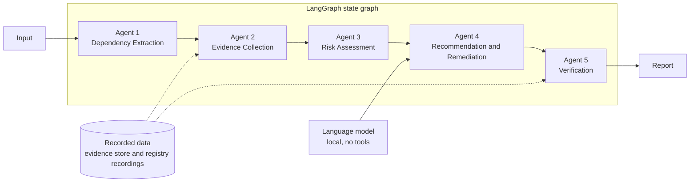
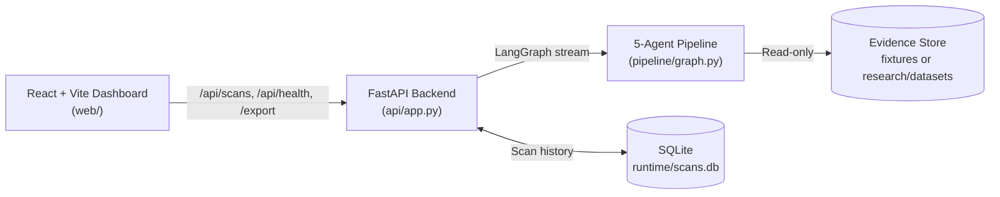

# Agentic Defense Against AI-Hallucinated Package Poisoning

An evaluation study of how language models fix risky software dependencies. When a scanner flags a package as malicious, typosquatted, vulnerable or nonexistent, and a model is asked what to do about it, two things can go wrong: the recommended fix can itself be unsafe, and the reasons the model gives can be unsupported by the evidence it cites. This project measures both, and measures what an independent, deterministic verifier changes.

## How it works

A five-agent pipeline turns a manifest into a report. Only the Recommendation and Remediation Agent (Agent 4) can use a language model.



| Agent | Role | Language model | Code |
|---|---|---|---|
| 1 Dependency Extraction | Parses `requirements.txt`, `pyproject.toml`, `Pipfile`, `package.json`, code imports and install commands | no | `agent1_ingestion` |
| 2 Evidence Collection | Checks each package against recorded PyPI and npm metadata and looks up its evidence records, filtered by a cut-off date | no | `agent2_registry` |
| 3 Risk Assessment | One finding per label family, version-aware, with evidence IDs | no | `agent3_risk` |
| 4 Recommendation and Remediation | Rules (R0), or a model given only the finding names (LLM-U) or the evidence records too (LLM-G) | LLM-U, LLM-G | `agent4_recommendation` |
| 5 Verification | Ten deterministic checks: accept, reject or abstain. Shares no code or model with Agent 4 | no | `agent5_verification` |

Every decision carries its reasons. Failures are explicit states, never defaults. Uploaded files are never installed, imported or executed.

## Main results (held-out test cases)

Three local models (Llama 3.2 3B, Qwen 2.5 3B, Qwen 2.5 7B) on 298 test cases, five label families, and two evidence cut-off settings for vulnerable packages:

- **Unsupported reasons.** With the evidence in the prompt, every model still made unsupported claims (for vulnerable packages: 8 of 24, 25 of 38 and 50 of 95 claims).
- **Unsafe fixes.** The two 3B models often kept a malicious or typosquatted package, or proposed a replacement that was itself malicious or a typosquat.
- **Verifier.** It delivered no unsafe recommendation without a cut-off: 100 unsafe recommendations removed, 5 of 396 acceptable ones wrongly rejected. The cost is coverage.
- **Rules.** The rule-based recommender was never unsafe without a cut-off and covered more cases.
- **Time.** Under cut-offs, every vulnerable target that was still delivered had its advisory published after the cut-off. The verifier removed every target whose advisory was already known.

Details: [`docs/research/RESULTS.md`](docs/research/RESULTS.md).

## Repository

| Path | Content |
|---|---|
| `src/multi_agentic_security/agents/` | The five agents |
| `src/multi_agentic_security/pipeline/` | LangGraph orchestration, guardrails, response cache |
| `src/multi_agentic_security/contracts/` | Typed contracts between the agents and for evidence records |
| `src/multi_agentic_security/datasets/`, `evidence_store/` | Source adapters and the evidence store |
| `src/multi_agentic_security/evaluation/` | Cases, scorer, metrics, statistics, held-out runner and report |
| `src/multi_agentic_security/api/` | FastAPI backend API, SQLite scan history (`runtime/scans.db`), and background orchestration |
| `web/` | React + Vite cybersecurity web dashboard |
| `tests/` | Unit, integration, and offline API tests (no network) |
| `docs/architecture/` | System architecture and agent contracts |
| `docs/datasets/DATASET_CATALOG.md` | Data sources, versions and licenses |
| `docs/research/` | Frozen evaluation protocol, amendments, splits, held-out plans and freeze records, results |
| `docs/paper/` | The paper and the literature review (IEEE format, LaTeX) |

## Run the web interface

### Technology stack & prerequisites

- **Backend:** Python >= 3.13, FastAPI, Uvicorn, LangGraph, Pydantic, SQLite (scan history only under `runtime/`)
- **Frontend:** Node.js LTS (v20+), npm, React, Vite
- **Optional LLM backends (Agent 4):** Rule-based mode (`R0`) requires no API key or model. For LLM modes (`LLM-G`, `LLM-U`), configure either Groq API (`AGENT4_GROQ_API_KEY1` + `AGENT4_GROQ_MODEL`) or local Ollama (`AGENT4_OLLAMA_MODEL`).

### Web architecture



### Installation (Windows PowerShell)

1. **Create and activate a Python virtual environment, then install dependencies:**

```powershell
python -m venv .venv
.\.venv\Scripts\Activate.ps1
python -m pip install -e ".[dev,web]"
```

2. **Install frontend dependencies:**

```powershell
cd web
npm install
cd ..
```

3. **Configure optional environment variables (only needed for LLM-G / LLM-U):**
   Per project rule D-064, no `.env.example` file is kept in the repository; all supported variable names are documented in [`docs/architecture/AGENT_CONTRACTS.md`](docs/architecture/AGENT_CONTRACTS.md). Create a git-ignored `.env` file in the repository root if using Groq or Ollama:

```env
AGENT4_GROQ_MODEL=llama-3.1-8b-instant
AGENT4_GROQ_API_KEY1=your_groq_api_key_here
AGENT4_LLM_TIMEOUT_SECONDS=60
AGENT4_LLM_MAX_OUTPUT_TOKENS=1024
```

### Start the backend and frontend

Open two PowerShell terminals in the repository root:

**Terminal 1 — FastAPI backend (`http://127.0.0.1:8000`):**

```powershell
$env:PYTHONDONTWRITEBYTECODE = "1"
.\.venv\Scripts\python.exe -m uvicorn multi_agentic_security.api.app:app --host 127.0.0.1 --port 8000
```

**Terminal 2 — React + Vite frontend (`http://127.0.0.1:5173`):**

```powershell
cd web
npm run dev -- --host 127.0.0.1 --port 5173
```

### Example workflow

1. Open `http://127.0.0.1:5173` in your browser and confirm the header displays **API Online**.
2. Upload `requirements.txt`, `package.json`, `package-lock.json`, code files, a `.zip` archive, paste `$ pip install ...` commands, enter a public GitHub repository URL, or click **Load Demo Sample**.
3. Choose the Agent 4 recommender (`R0`, `LLM-G`, or `LLM-U`) and Agent 2 registry mode (`snapshot`, `live`, or `off`), then click **Start Dependency Analysis**.
4. Watch real-time stage progress across Agents 1–5, click any package row to inspect deterministic evidence and Agent 5's 10 verification checks alongside Agent 4's recommendation, and export the final JSON report.

### Known limitations

- **Parsed manifests:** Agent 1 parses `requirements*.txt`, `*.in`, `package.json`, `package-lock.json`, `npm-shrinkwrap.json`, Python/JS/TS imports, shell scripts, Dockerfiles, Markdown code blocks, ZIP archives, and public GitHub links. `pyproject.toml` and `Pipfile` are reported explicitly as `a1.source.unsupported_manifest`.
- **Evidence store:** Without the separate 106 MB normalized dataset under `research/datasets/verified/normalized/v1/`, the web server defaults to the offline test fixture evidence store (`tests/fixtures/agent2/evidence/v1/`).
- **Missing vs. malicious:** Packages absent from a registry (`not_found`) are never automatically labeled confirmed malicious without malware/typosquat evidence.

## Running the tests

Python 3.13 (all unit, integration, and offline API tests):

```powershell
$env:PYTHONDONTWRITEBYTECODE = "1"
.\.venv\Scripts\python.exe -m pytest -q -p no:cacheprovider --basetemp=.pytest_tmp
```

Frontend lint and production build:

```powershell
cd web
npm run lint
npm run build
```

## Data

The research data is **not** in this repository. It comes from public research datasets (LibHalluBench, Package Hallucination, Ecosyste.ms Typosquatting, You Can't Touch This, OpenSSF Malicious Packages, DataDog manifests, OSV.dev, PyPI MalRegistry listing, PyPI popular packages and real-world manifests), described with sources and licenses in `docs/datasets/DATASET_CATALOG.md`. Some of these sources contain live malware or have no redistribution rights. Do not install or run anything from them.

## Authors

Chandan Prakash Hegde, Gaargi L, Disha T P, Chethan Magudilu Shivanna, and Spoorthi M (Assistant Professor). Department of Information Science and Engineering, Dayananda Sagar College of Engineering, Bangalore, India.

## License

Not yet chosen.
