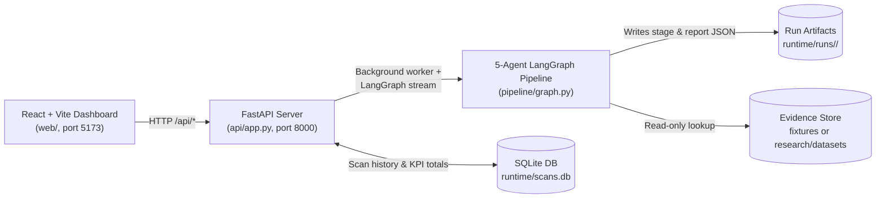

# Project Completion & Web Integration Walkthrough

**Project Title:** Agentic Defense Against AI-Hallucinated Package Poisoning Using Multi-Agent Dependency Verification  
**Repository:** `ChandanHegde15/multi-agentic-security-system`

This document explains everything that existed in the repository, what was validated, what was built on top of the existing multi-agent core, how database persistence works across server restarts, and how to demonstrate and explain the full system.

---

## 1. What Already Existed (Preserved Untouched)

Before adding the web layer, the core multi-agent Python library and its research artifacts were already implemented in `src/multi_agentic_security/`:

| Module | Purpose | LLM Used? |
|---|---|---|
| `agents/agent1_ingestion/` | **Agent 1 — Dependency Extraction:** Parses `requirements*.txt`, `*.in`, `package.json`, `package-lock.json`, Python/JS/TS imports, shell scripts, Dockerfiles, Markdown code blocks, ZIP archives, and public GitHub repo links in memory (never installs or executes uploaded code). | No (deterministic) |
| `agents/agent2_registry/` | **Agent 2 — Registry & Evidence Collection:** Queries package metadata (`off`, `snapshot` fixtures, or `live` PyPI/npm metadata) and looks up records in the read-only `EvidenceStore` across separate label families (`malicious`, `withdrawn`, `typosquat`, `vulnerable`, `nonexistent`, `benign_reference`). | No (deterministic) |
| `agents/agent3_risk/` | **Agent 3 — Risk Assessment:** Runs the frozen v1 baseline (`baseline_v1/`) side-by-side with v2 family-separated, version-aware findings (`malicious_reported`, `compromised_version`, `withdrawn_only`, `vulnerable`, `typosquat_listed`, `nonexistent`, `registry_security_hold`, `name_similar_to_popular`, `unknown`, `no_evidence`). | No (deterministic) |
| `agents/agent4_recommendation/` | **Agent 4 — Recommendation & Remediation:** Produces structured actions (`remove`, `replace`, `upgrade`, `downgrade`, `keep`, `investigate`, `abstain`) and cited claims using either `R0` deterministic rules, `LLM-G` (grounded with evidence), or `LLM-U` (finding names only) via `GroqClient` or `OllamaClient`. | Optional (`R0` uses none) |
| `agents/agent5_verification/` | **Agent 5 — Independent Verification:** Shares **no code or model** with Agents 3 or 4. Re-derives 10 deterministic checks (`schema`, `dependency_identity`, `action_allowed`, `claims_supported`, `target_exists`, `target_not_malicious`, `target_not_typosquat`, `target_version_not_vulnerable`, `replacement_matches_reference`, `action_consistent`) and outputs `accept` (Verified), `reject` (Rejected), or `abstain` (Needs Review). | No (deterministic) |
| `pipeline/graph.py` | **LangGraph Orchestrator:** Connects `guard_input → extract → extract_guard → registry → risk → recommend → verify → report`, validates Pydantic `pipeline/0.2` contracts at every boundary, checks outputs for secret patterns (`guardrails.py`), and writes stage JSON artifacts to `run_dir`. | Coordinates Agent 4 |
| `evidence_store/` & `tests/fixtures/agent2/` | **Evidence Store:** Loads SHA-256-verified JSONL tables from `MANIFEST.json`. Includes the offline fixture store (`tests/fixtures/agent2/evidence/v1/`, 18 records) and 14 recorded registry snapshots (`tests/fixtures/agent2/registry_snapshot/`). | No |

**Preservation Guarantee:** Zero files inside `src/multi_agentic_security/agents/`, `contracts/`, `evidence_store/`, `pipeline/`, `evaluation/`, `datasets/`, or `docs/research/` were modified.

---

## 2. Environment Setup & Existing System Validation

1. **Local Environment Configured (Windows 11, Python 3.13.15, Node.js v26.13.1):**
   - Created a local Python virtual environment at `.venv/` (git-ignored).
   - Installed the package in editable mode along with FastAPI/Uvicorn web dependencies and missing `semver>=3` (required by `versioning/npm_semver.py` and added to `pyproject.toml`).
   - Kept the repository free of `.env.example` in accordance with existing project rule **D-064** (verified by `tests/unit/test_agent4_llm.py::test_variable_names_are_documented_and_no_template_is_kept`).
2. **Baseline Pipeline Validation (Offline):**
   - Executed the full existing `pytest` suite before adding any new code (`1,319 passed, 3 skipped` in sandbox; `1,328 passed, 1 skipped` overall after adding the 7 offline API tests).
   - Verified Scenarios A–E on the existing pipeline (`requests` valid, `reqeusts-hallucinated` nonexistent, `strign-width` typosquat + verified replacement `string-width`, `evil-pkg` npm security hold, `timeoutpkg` / `brokenpkg` lookup failures staying `unknown`/`abstain` rather than mislabeled malicious).

---

## 3. What Was Built (Backend API + Web Interface + Persistence)



### A. Backend API (`src/multi_agentic_security/api/`)
- **`storage.py` (`ScanStore`):** Manages the SQLite database at `runtime/scans.db` and reads full `PipelineReport` JSON files from `runtime/runs/<scan_id>/report.json`.
  - Why SQLite is separate from the evidence store: Per `docs/WEB_HANDOVER.md`, the `EvidenceStore` remains a frozen set of SHA-256-verified JSONL files, while SQLite stores only scan history, stage status, summary counts, and failures.
- **`service.py` (`ScanService`):**
  - Validates uploaded files (manifests, code, `.zip`), pasted text, or public GitHub URLs (`https://github.com/...`).
  - Rejects invalid inputs cleanly with HTTP `400` (empty input, unsupported binary/file types, path traversal, live mode + cut-off conflict, missing LLM config) without exposing stack traces or credentials.
  - Executes `build_graph(cfg).stream(..., stream_mode="updates")` in a background `ThreadPoolExecutor` so long scans never block the API and each agent's real progress (`pending` → `running` → `done` / `failed`) updates SQLite live.
- **`app.py`:** Exposes:
  - `GET /api/health` — Backend readiness, evidence store source (`fixture` vs `full`), record count, and LLM configuration status.
  - `GET /api/scans` — Aggregate KPI counts (`packages_analyzed`, `verified`, `suspicious`, `not_found`, `needs_review`, `rejected`) and recent scans from SQLite.
  - `POST /api/scans` — Starts a scan from uploaded files/ZIP, pasted snippet, or GitHub URL.
  - `GET /api/scans/{scan_id}` — Returns live stage status, failures, and the full `PipelineReport`.
  - `GET /api/scans/{scan_id}/export` — Downloads `security-report-<scan_id>.json`.
- **`tests/api/test_api.py`:** 7 offline `TestClient` tests (all outbound network calls blocked) validating every endpoint, ZIP/GitHub/text inputs, Agent 5 rejection of unsafe LLM output, export, dashboard stats, and error handling.

### B. Web Interface (`web/`)
Built with **React 19 + Vite + Lucide icons** in a dark-navy cybersecurity theme:
- **Top Status Bar & Real KPI Cards:** Displays live backend health, loaded evidence store count, and aggregate counts read directly from `runtime/scans.db` (zero hardcoded stats).
- **New Dependency Scan Panel (`ScanInputPanel.jsx`):** Supports drag-and-drop file/ZIP upload, public GitHub URLs, pasted code/commands, a 1-click **Load Demo Sample** button, Agent 4 recommender selector (`R0`, `LLM-G`, `LLM-U`), Agent 2 registry mode selector (`snapshot`, `live`, `off`), optional cut-off date, and Agent 5 verifier gate toggle.
- **Recent Scans List:** Persisted in `runtime/scans.db`; every time you restart the backend and frontend, all previous scans appear in the sidebar and clicking any scan loads its full saved report from `runtime/runs/<scan_id>/report.json`.
- **Pipeline Progress (`PipelineProgress.jsx`):** Reflects real backend stage execution across all 5 agents + final report.
- **Results Overview & Per-Agent Tabs (`AgentTabsView.jsx`, `PackageResultsTable.jsx`):** Searchable/filterable table with clear statuses (`Verified`, `Suspicious`, `Not Found`, `Needs Review`, `Rejected`), dedicated tabs for **Agents 1–5**, a **Final Report** summary tab, and JSON report download.
- **Package Inspector (`PackageDetailView.jsx`):** Clearly separates deterministic Agent 2/3/5 evidence and all 10 verification checks from Agent 4's recommendation and AI/rule rationale.

---

## 4. Understanding Registry Modes (`snapshot` vs `live`) & Persistence

1. **Are all scans saved in the database across restarts?**
   - **Yes.** Every scan's metadata, stage statuses, summary metrics, and failures are stored in SQLite at `runtime/scans.db`, and each scan's complete JSON report (`extract.json`, `registry.json`, `risk.json`, `recommend.json`, `verify.json`, `report.json`, `RUN_RECORD.json`) is saved in `runtime/runs/<scan_id>/`.
   - Both `runtime/scans.db` and `runtime/runs/` are git-ignored under `runtime/` so your local scan history persists across server restarts without polluting Git commits.
2. **Why do real/custom packages show `registry: not_checked` in `snapshot` mode?**
   - In **`snapshot`** mode, Agent 2 reads only the 14 offline fixture files in `tests/fixtures/agent2/registry_snapshot/` (used for offline testing and the Demo Sample). Any package outside those 14 fixtures is marked `not_checked` (`a2.not_checked.not_in_snapshot`), which leads Agent 3 to mark existence `unknown` and Agent 5 to output `Needs Review (abstain)`.
   - When scanning real GitHub repositories (e.g. `VIKASHL25/SIH-26228`) or custom hallucinated package names (e.g. `expresss`, `reactt`, `flask-authentication-ultra`), switch **Agent 2 Registry Mode** to **`Live (PyPI / npm Metadata)`**. Agent 2 will query `pypi.org` and `registry.npmjs.org` metadata live (still without downloading or installing any package) and classify missing packages as `not_found` → `nonexistent` → `remove`.

---

## 5. Exact PowerShell Commands to Run & Test

**Start Backend (`http://127.0.0.1:8000`):**
```powershell
$env:PYTHONDONTWRITEBYTECODE = "1"
.\.venv\Scripts\python.exe -m uvicorn multi_agentic_security.api.app:app --host 127.0.0.1 --port 8000
```

**Start Frontend (`http://127.0.0.1:5173`):**
```powershell
cd web
npm run dev -- --host 127.0.0.1 --port 5173
```

**Run All Backend + API Tests (1,328 passed, 1 skipped):**
```powershell
$env:PYTHONDONTWRITEBYTECODE = "1"
.\.venv\Scripts\python.exe -m pytest -q -p no:cacheprovider --basetemp=.pytest_tmp
```

**Run Frontend Lint & Production Build:**
```powershell
cd web
npm run lint
npm run build
```
